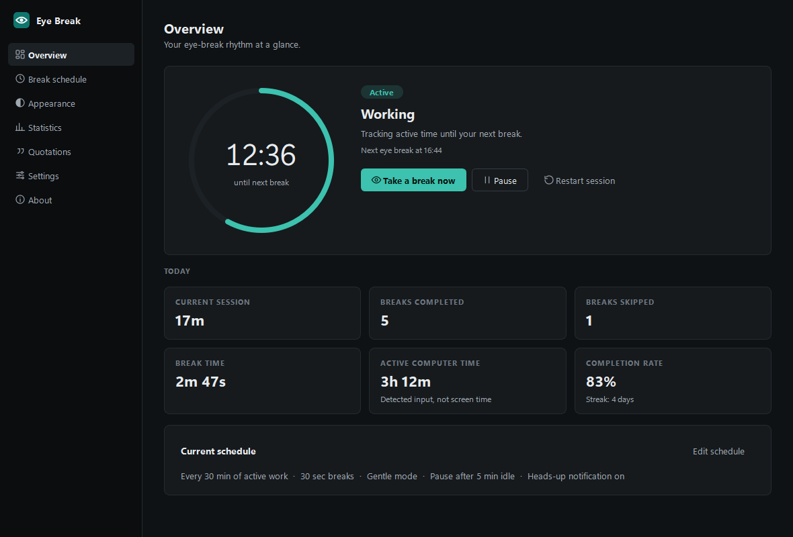

# Eye Break

A calm, offline Windows desktop app that reminds you to rest your eyes. After a configurable
amount of active computer time it gently dims every screen, shows a short quotation, a countdown
and a practical relaxation tip, then gets out of the way on its own.



## Features

- **Full-screen break overlay** on every monitor: 80% black by default (adjustable 50–100%), with
  fully opaque text and controls, smooth fades, and correct handling of DPI scaling and monitors
  being plugged in or removed.
- **Flexible schedule**: 20/30/45/60/90/120-minute presets or any custom interval from 1 to 180 minutes;
  breaks from 10 seconds to 60 minutes. Changes apply immediately.
- **Three modes**: *Gentle* (heads-up notification, free skip/snooze), *Focus* (limited snoozes,
  skipping asks for confirmation), *Strict* (no skip/snooze buttons, with an always-available
  emergency exit).
- **Idle detection**: the timer pauses when there is no keyboard/mouse input, and locked screens and
  sleep are never counted. Optionally, a long absence restarts the session.
- **System tray**: next-break countdown, take a break now, snooze, pause (30 min / 1 h / 2 h / until
  tomorrow / indefinitely), meeting mode (15 min to 2 h, custom, until resumed).
- **Meeting mode**, plus optional automatic pausing while Windows reports a full-screen app, game or
  presentation.
- **Statistics** stored locally in SQLite: completed, skipped, snoozed and interrupted breaks, break
  time, detected active time, completion rate, streaks, charts, CSV export and one-click deletion.
- **106 original quotations** in 7 categories, plus your own; rotation avoids repeats.
- **Light, dark and system themes**, 6 accent colours, a live overlay preview and a full-screen preview.
- **Optional** pre-break notifications, soft sounds, and water/stand/stretch/posture/walk reminders.
- **Start with Windows** (per user, no administrator rights) and a single running instance.

## Privacy

Eye Break is completely offline: no accounts, telemetry, analytics or network requests. Idle
detection only asks Windows *when* the last input happened. Nothing is recorded about what you type,
your screen or your applications. Preferences, history and logs live in `%APPDATA%\EyeBreak`.

## Install

1. Download `EyeBreak-1.0.0-Setup.exe` and run it. It installs per user (no administrator rights needed).
2. Windows SmartScreen may warn that the publisher is unknown, because the executable is **not code-signed**.
   Choose **More info → Run anyway** only if you trust where you got the file. Eye Break does not try to
   bypass this protection.
3. Optional during setup: a desktop shortcut and start-with-Windows.

Uninstalling (Settings → Apps, or the Start menu) removes the program and its startup entry. It asks
whether to also delete your settings and history.

**Portable alternative:** copy the `dist\EyeBreak` folder anywhere and run `EyeBreak.exe`.

### Strict mode emergency exit

Hold **Esc for 3 seconds** while the overlay has focus (click it first if needed), or right-click
the tray icon and choose **End break now (emergency)**. Eye Break never blocks Ctrl+Alt+Del,
Task Manager, accessibility tools or the lock screen.

## Development

Requirements: Windows 10/11, [uv](https://docs.astral.sh/uv/). uv installs Python 3.12 automatically.

```powershell
uv sync                                     # create .venv with all dependencies
uv run python main.py                       # run from source
uv run python main.py --data-dir .devdata --dev-speed 30   # isolated data, clock 30x faster
uv run pytest                               # 90 automated tests (headless, two simulated monitors)
$env:EYE_BREAK_TEST_QPA="windows"; uv run pytest   # same tests on the real desktop
uv run python scripts/smoke_test.py         # real-desktop smoke test + CPU/RAM measurement
uv run python scripts/screenshots.py        # regenerate docs/screenshots
uv run python scripts/make_assets.py        # regenerate the icon and sounds
```

Command-line options: `--minimized`, `--data-dir PATH`, `--dev-speed N` (development only),
`--quit` (ask the running instance to exit), `--version`.

### Build

```powershell
powershell -ExecutionPolicy Bypass -File scripts\build.ps1
```

This runs the tests, builds `dist\EyeBreak\EyeBreak.exe` with PyInstaller, and, if
[Inno Setup 6](https://jrsoftware.org/isinfo.php) is installed, builds
`packaging\output\EyeBreak-1.0.0-Setup.exe`.

## Documentation

- [Architecture](docs/ARCHITECTURE.md)
- [Testing and verification report](docs/TESTING.md)
- [Release notes](docs/RELEASE.md)
- [Development progress](docs/PROGRESS.md)

## License

MIT; see [LICENSE](LICENSE). Built with Qt for Python (PySide6), used under the LGPL v3. The icons,
sounds and quotations are original to this project.

Eye Break encourages healthy screen habits. It is not a medical device. If you have persistent eye
discomfort, please consult an eye-care professional.
